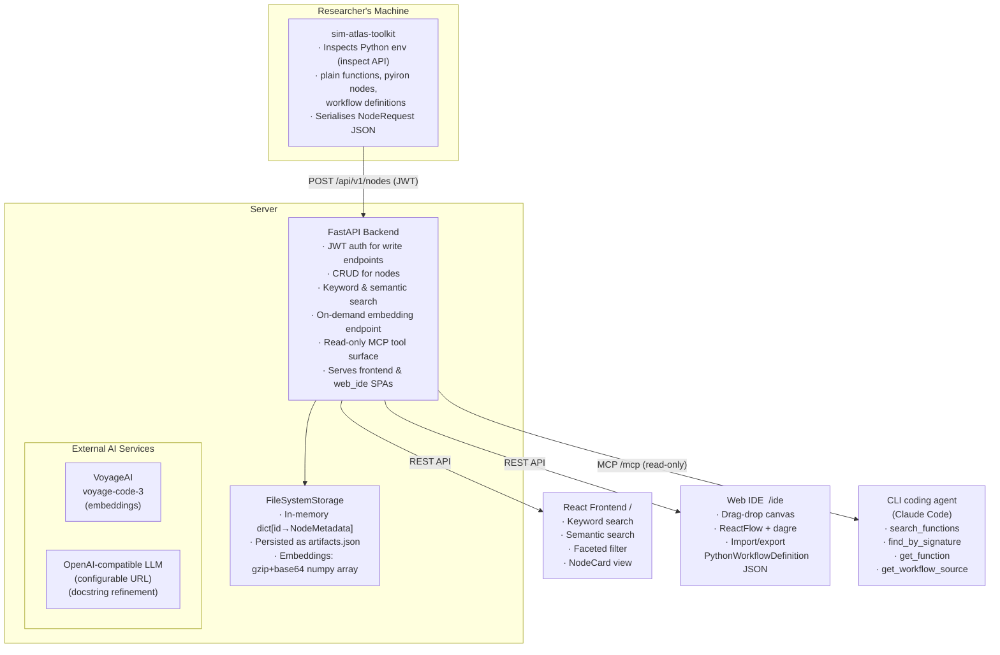
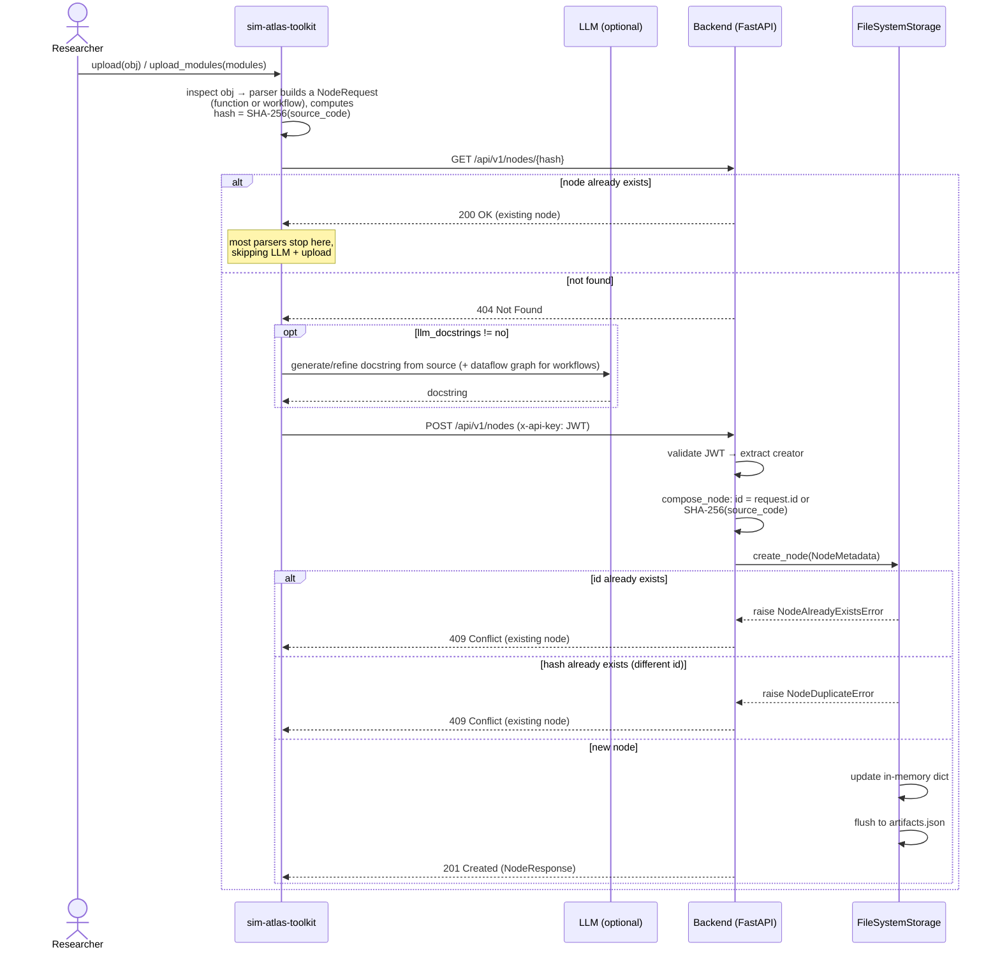

# Software Architecture Document
## Sim Atlas — Simulation Node Search & Discovery Platform

**Version:** 0.2  
**Status:** Active  
**Date:** 2026-04-02

---

## 1. Overview

Sim Atlas is a search and discovery platform for simulation nodes — Python functions, workflow definitions, and pyiron nodes used in scientific computing. Users parse their locally installed Python packages or modules using the **toolkit** client library, then push the extracted metadata to a central server where it becomes searchable by all users via a **React search frontend**.

The system is structured as a **monorepo** containing four sub-packages: `backend`, `frontend`, `web_ide`, and `toolkit`.

---

## 2. Goals & Non-Goals

**Goals**
- Enable fast, faceted search over simulation node metadata (name, docstring, inputs/outputs with physical units and quantities)
- Support semantic search via AI-generated embeddings
- Never execute arbitrary user-provided code on the server
- Keep the server stateless with respect to parsing logic
- Expose a read-only, Python-shaped MCP tool surface for CLI coding agents (ADR-0019)
- Provide a visual drag-and-drop workflow composer

**Non-Goals**
- Code execution or sandboxing on the server
- Version control or diff tracking of parsed codebases
- Freshness guarantees — upstream source changes are silently stale (see ADR-0012)
- Multi-tenancy (writes are authenticated but reads are public for v0.1)

---

## 3. Repository Layout

```
sim_atlas/
├── backend/          Python package: sim-atlas-backend (FastAPI server)
├── frontend/         React SPA: keyword & semantic search portal
├── web_ide/          React SPA: visual workflow composer
├── toolkit/          Python package: sim-atlas-toolkit (parser + upload client)
└── docs/             Architecture docs, ADRs
```

The frontend and web_ide build artefacts are served as static files by the backend (see §4.2), producing a single deployable unit.

---

## 4. System Components



The CLI coding agent is a *second*, independent AI surface: the backend hands it
Python (signature, import line, install hint) and it owns the local environment —
checking what is importable and proposing installs itself. See
ADR-0019.

---

## 5. Data Flow

### Upload Flow



### Search Flow

```mermaid
sequenceDiagram
    actor U as User
    participant F as React Frontend
    participant B as Backend (FastAPI)
    participant S as FileSystemStorage
    participant E as Embedding Provider<br/>(fastembed local, or<br/>OpenAI/VoyageAI API)

    U->>F: enter query + set facet filters
    F->>B: POST /api/v1/search {query, filter, mode, semantic, page, limit}
    Note over B: mode defaults to hybrid,<br/>or keyword when semantic == false
    alt mode == keyword
        B->>S: search(): apply NodeFilter → keyword leg
        S-->>B: sorted, paginated SearchResults
    else mode == substring
        B->>S: search_substring(): substring leg → apply NodeFilter
        S-->>B: sorted, paginated SearchResults
    else mode == semantic
        B->>E: create_embedding(query, input_type="query")
        E-->>B: query vector
        B->>S: search_semantic(): apply NodeFilter → semantic leg
        S-->>B: sorted, paginated SearchResults
    else mode == hybrid → search_hybrid()
        alt no query
            B->>S: fall back to search() (filtered set, unranked)
            S-->>B: paginated SearchResults
        else
            opt embeddings_enabled
                B->>E: create_embedding(query, input_type="query")
                E-->>B: query vector
            end
            B->>S: apply NodeFilter once, then rank with every leg that runs
            Note right of S: substring leg: name/import substring,<br/>tier (prefix > word start > inside name > import)<br/>then coverage<br/>keyword leg: best-field score per term<br/>(exact, prefix and near-spelling matches)<br/>semantic leg: cosine similarity<br/>(nodes with an embedding only)
            S->>S: weighted RRF (search/fusion.py): Σ w·1/(60+rank)<br/>ties share a rank; weights renormalised per node,<br/>so an unembedded node is fused as if<br/>the semantic leg had not run
            S-->>B: sorted, paginated SearchResults
        end
    end
    B-->>F: ScoredSearchResponse (ScoredSearchItem[])
    F->>U: render NodeCard components
```

---

*End of document.*